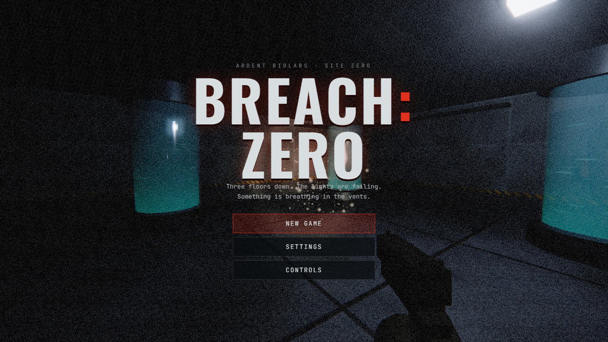

# BREACH: ZERO

A fast, dark first-person horror shooter for the browser. You are trapped three floors under Ardent Biolabs after a containment breach. Find the keycards, fight what the lab made, restore power, and survive until the freight lift reaches you.

**Play:** https://merchantsteam29.github.io/breach-zero/



## Controls (keyboard and mouse)

| Key | Action |
| --- | --- |
| W A S D | Move |
| Mouse | Look |
| Left click / Right click | Shoot / aim down sights |
| Shift | Sprint (uses stamina, loud) |
| Space | Jump (you can climb onto crates) |
| C | Crouch (quiet, harder to spot) |
| R | Reload |
| F | Flashlight (drains; recharges while off) |
| E | Use audio logs, the breaker, lifts |
| Q | Use a medkit |
| 1 / 2 / mouse wheel | Pistol / shotgun |
| Esc | Pause |

## What's in it

- Three handmade floors: Cryogenics, Biohazard Research, Reactor & Surface Access. Each has keycard doors (blue, red, yellow) and a lift.
- Four monster types: husks, fast pouncing crawlers, a charging brute, and acid-spitting spitters. Some hide in the vents and drop on you when you grab a keycard.
- Monsters hunt by sound and light. Gunshots carry down the corridors, sprinting is loud, and your flashlight beam gives you away.
- Pistol and shotgun, with reloading, recoil, hit markers and headshots.
- Health, stamina and a flashlight battery, plus medkits.
- Nine audio logs that tell what happened in the lab.
- Finale: pull the reactor breaker, then hold out until the freight lift arrives.
- Easy, Normal and Nightmare difficulty. A checkpoint is saved at the start of every floor.
- Settings: sensitivity, field of view, brightness, volumes, graphics quality (Low/Medium/High), invert Y, head bob, and reduced flashing.
- All sound is synthesised live with WebAudio, and all textures are generated in code, so there are no asset files.

## Run locally

```
node serve.js        # then open http://localhost:8080
```

Plain HTML and ES modules, with Three.js 0.160 from a CDN. There is no build step.

## Tests

```
node tools/check-maps.mjs            # every floor is finishable, doors are valid
node tools/playtest/run-all.mjs      # headless Chrome playthroughs (needs Chrome)
```

`?test` in the URL exposes `window.__bz` for the playtests. Screenshots go to `tools/playtest/shots/`. Headless Chrome renders in software at a few frames per second, so game time runs slowly there and frame rates mean nothing.
